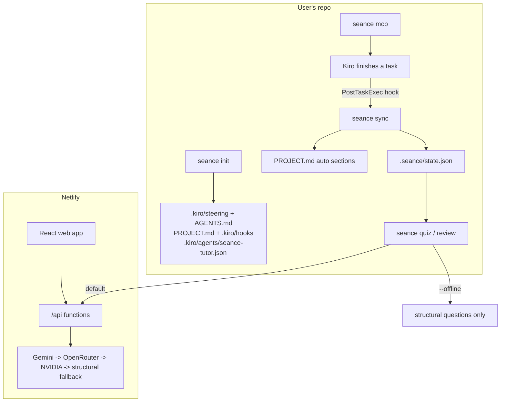

# Seance: Project Brief (Kiroween 2026, Frankenstein category)

> This file supersedes `SEANCE_PROJECT_BRIEF.md` (the older web-app-first brief, kept for history).
> Owner: Vedant Hande. Deadline: Fri Dec 4 2026, 2:00 PM PT. Aim to submit Dec 3 IST.

**Pitch:** "A terminal tool, a compiler's parser, a 1987 flashcard algorithm, and an AI agent, stitched together so AI can write your code without you losing track of it."

## Problem
Beginner developers let AI agents write code they cannot explain, and the agents often ignore good practice. Seance gives every project rules for AI agents and a PROJECT.md that updates itself after each task. It then quizzes the developer on what the AI just built and brings missed concepts back with SM-2 spaced repetition.

## Requirements
- Solo developer, limited time; most implementation is handed to Kiro.
- CLI commands:
  - `seance init`: npm-init-style Q&A. Writes AI rules (Kiro steering + AGENTS.md), PROJECT.md, Kiro hooks, and a custom agent.
  - `seance sync`: updates the PROJECT.md auto sections from the git diff. Triggered by a Kiro `PostTaskExec` hook.
  - `seance quiz`: quiz on the latest change.
  - `seance review`: SM-2 review of missed concepts.
  - `seance mcp`: MCP server for Kiro.
  - `seance ui` (optional): serves the web build locally.
- Web app with a small hosted backend (no judge setup), a demo project, and a paste-code mode.
- AI chain: Gemini -> OpenRouter -> NVIDIA (OpenAI-compatible), then a deterministic fallback from the code structure. 8 s per provider, 20 s total. Keys server-side only. Per-IP rate limit and 100 KB input cap.
- Security rules generated by `init` (and used here): pin versions, commit the lockfile, run `npm audit`, avoid freshly published packages, ask before adding dependencies, validate all AI output with zod, no secrets in code.
- "Ask until 90% sure" = a measurable completeness checklist in `init`, plus a steering rule to ask clarifying questions until required info is complete.
- Use every judged Kiro feature: custom agents, hooks, specs, steering, MCP, PBT, powers, plus IDE/CLI/Web (Crew optional).
- `docs/KIRO_USAGE.md` maintained from day 1; it becomes the write-up.
- Public GitHub repo, MIT license, `.kiro/` committed and never gitignored.

## Tech stack
| Layer | Choice |
|---|---|
| Language | TypeScript (ESM), Node.js >=22.12 |
| Repo | npm workspaces: `packages/core`, `packages/cli`, `packages/power`, `apps/web` |
| CLI | commander + @inquirer/prompts |
| Code parsing | @babel/parser (JS/TS); other languages get a file-level map only |
| Validation | zod |
| AI | `openai` SDK with three base URLs; URLs and models from env |
| MCP | @modelcontextprotocol/sdk (stdio) |
| Frontend | Vite + React + Tailwind + shadcn/ui; dark theme, one accent, light Halloween wording |
| Backend | Netlify Functions in `apps/web/netlify/functions` |
| Storage | `.seance/state.json` in the user's repo; localStorage on the web. No DB. |
| Tests | vitest + fast-check |
| Deploy | Netlify (via the Netlify Kiro power); CLI published to npm |

## Architecture

The CLI quiz uses the hosted API by default; `--offline` or the user's own env keys bypass it. The README must disclose that code is sent to the API.

## How each Kiro feature is used
| Feature | During the build | Inside the product |
|---|---|---|
| IDE | Specs, tasks, hooks (main tool) | - |
| CLI | Run the custom agents; one headless task run | - |
| Web | Task 12 README as a cloud session that opens a PR | - |
| Crew (optional) | Daily job: summarize usage log, remind of due reviews | - |
| Custom agents | `architect` (Opus 5.5), `builder` (Sonnet 5.5), `reviewer` (Sonnet 5.5, read-only) | `seance-tutor`, uses the MCP tools |
| Hooks | `test-core-on-save` (PostFileSave), `log-usage` (Stop, zero tokens) | `seance sync` on PostTaskExec; PreToolUse dependency guard |
| Specs | One spec per feature, EARS, PBT enabled | - |
| Steering | product, tech, structure, security (always, short); model-budget (manual) | Generated by `init` |
| MCP | Seance's own server, used while building | `get_project_context`, `get_due_reviews`, `start_quiz`, `submit_answer` |
| PBT | SM-2, gate, PROJECT.md merge, question generator, AI chain | - |
| Powers | Netlify power for deploy | Seance packaged as a Kiro power |

## Model and credit plan
See `.kiro/steering/model-budget.md` (manual inclusion, load with `#model-budget`).

## Tasks
1. **Repo foundation and Kiro setup** (Sonnet 5.5). Workspaces, TS, vitest, fast-check, LICENSE, .gitignore, .env.example, steering, three agents, test-on-save and usage-log hooks, KIRO_USAGE.md, PROJECT.md, placeholder core test.
2. **Review engine** (Opus spec, Sonnet code). `nextReview(card, quality)`, `gateDecision(score, passMark, mode)`, `scoreQuiz(questions, answers)`. Spec first in `.kiro/specs/review-engine/`.
   - SM-2: if q < 3, repetitions = 0 and interval = 1. Else repetitions += 1; interval = 1, then 6, then round(interval * ease). ease = max(1.3, ease + 0.1 - (5 - q)(0.08 + (5 - q) * 0.02)). dueAt = today + interval days.
   - Gate modes off / soft / strict; soft = "allowed but not understood".
   - Properties: ease >= 1.3; q < 3 resets repetitions; intervals never shrink across successes; score in [0,1]; strict never passes below the pass mark.
   - Demo: script prints review dates for ratings 5, 5, 2, 4.
3. **Structure map + structural questions** (Sonnet). `buildStructureMap(files)` with @babel/parser (imports, exports, functions, classes, simple calls); `generateStructuralQuestions(map)` deterministic MCQs tagged with a concept. Size limits. Properties: correct answer in choices, unique choices, deterministic. Snapshot tests on fixtures. Demo: `npx tsx scripts/map.ts fixtures/sample.ts`.
4. **AI provider chain** (Opus). `generateQuiz(map, code)`, `gradeExplanation(answer, rubric)`. openai SDK, three base URLs, 8 s / 20 s, zod, fall through on invalid output, Task 3 fallback, report the provider. Quiz: 3 MCQ, 1 "what if we change X?", 1 "explain in your own words" with rubric. Tests: mocked fetch; property: any failure mix yields a valid quiz.
5. **`seance init`** (Sonnet). Q&A writes steering + AGENTS.md, PROJECT.md with markers, `.seance/config.json`, sync hook, PreToolUse dependency guard, `seance-tutor` agent. Completeness checklist with "I don't know, suggest options". Re-running never overwrites edited files. Tests: temp dir snapshots; second run leaves edits alone.
6. **`seance sync`** (Opus). Git diff since last sync, structure map of changed files, `mergeAutoSections` only between markers, changelog entry (AI summary or diff stat), pending quiz saved. Wired to the task hook. Properties: outside-marker text preserved, merge idempotent. Integration test on a temp git repo.
7. **`seance quiz` / `seance review`** (Sonnet). Structure map first, then quiz; `scoreQuiz` + `gateDecision`; misses become SM-2 cards; `review` walks due cards. `--offline`.
8. **Hosted backend** (Sonnet). `POST /api/structure`, `/api/quiz`, `/api/grade`. Env keys, per-IP rate limit, 100 KB cap, zod bodies, friendly errors. Tests: bad input, oversized body, rate limit, fallback.
9. **Web app** (Sonnet). Screens: Summon, Structure map, Quiz, Results (shows provider), Review (localStorage), Project (demo PROJECT.md). Wording: "Summon", "The spirits ask...", "Banish doubts".
10. **Deploy and publish** (Sonnet). Netlify power, env vars, private-window check, npm publish after a name check, notes in KIRO_USAGE.md.
11. **MCP server + Seance power** (Opus). Four tools; registered in `.kiro/settings/mcp.json`; `packages/power` with a "quiz me" skill; `seance-tutor` uses the tools; test in IDE and CLI.
12. **Dogfood, docs, submission** (Sonnet; Haiku for text; README via Kiro Web). README in <= 5 commands, finish KIRO_USAGE.md, Devpost text, video script < 3 min. User writes the social post (#KiroweenHackathon26 first) and blog (mentions Kiroween 2026).

## Schedule
| Date | Tasks |
|---|---|
| Nov 26 | 1 |
| Nov 27 | 2, 3 |
| Nov 28 | 4, 5 |
| Nov 29 | 6, 7 |
| Nov 30 | 8, 9 (start) |
| Dec 1 | 9 (finish), 10 |
| Dec 2 | 11 |
| Dec 3 | 12, video, blog, social post, Devpost form |
| Dec 4 | Buffer, submit |

**Cut order if behind:** Crew job, Kiro Web comparison, power packaging (keep the MCP server), AI grading of the explain question, `--offline` polish. Never cut `init`, `sync`, the quiz, the web app or deployment.

## Working rules
Follow steering and security rules. Ask before adding dependencies or running hard-to-reverse commands. No secrets in commits. Update `docs/KIRO_USAGE.md` and PROJECT.md after each task. Stop after each task and report.
